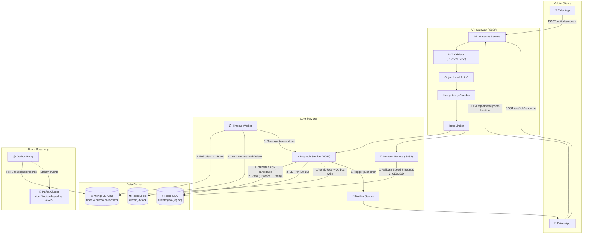
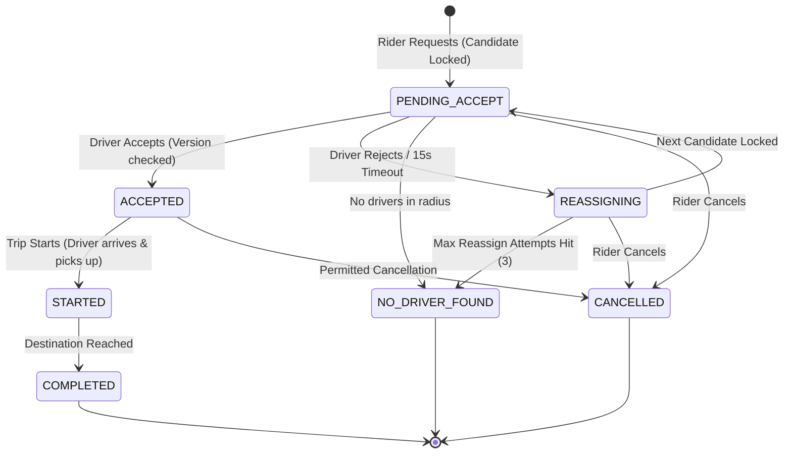

# 🚖 Real-Time Ride Dispatch Engine

A high-throughput, geo-distributed ride matching and dispatch backend built in **Go**. It matches ride requests to the nearest available driver in real time, guarantees that **no driver is ever double-assigned**, survives complete infrastructure restarts without losing requests, and provides full production observability.

---

## 📋 Table of Contents
1. [Core Features & Acceptance Criteria](#-core-features--acceptance-criteria)
2. [High-Level Architecture](#-high-level-architecture)
3. [Source of Truth & Storage Strategy](#-source-of-truth--storage-strategy)
4. [How the Engine Works (Step-by-Step Examples)](#-how-the-engine-works-step-by-step-examples)
   - [Flow 1: Requesting a Ride](#flow-1-requesting-a-ride)
   - [Flow 2: Driver Location Ingestion & Anti-Spoofing](#flow-2-driver-location-ingestion--anti-spoofing)
   - [Flow 3: Driver Response & Zero Double-Booking](#flow-3-driver-response--zero-double-booking)
   - [Flow 4: Timeout Worker & Automated Re-assignment](#flow-4-timeout-worker--automated-re-assignment)
5. [Ride State Machine](#-ride-state-machine)
6. [Repository & Code Structure](#-repository--code-structure)
7. [Getting Started (Step-by-Step Setup)](#-getting-started-step-by-step-setup)
   - [Prerequisites](#prerequisites)
   - [Step 1: Environment Setup](#step-1-environment-setup)
   - [Step 2: Start Infrastructure (Docker)](#step-2-start-infrastructure-docker)
   - [Step 3: Run Database Migrations](#step-3-run-database-migrations)
   - [Step 4: Seed Simulated Drivers](#step-4-seed-simulated-drivers)
   - [Step 5: Run Services](#step-5-run-services)
8. [Testing & Verification](#-testing--verification)
   - [Unit & Race Detector Tests](#unit--race-detector-tests)
   - [Concurrency Race Tests (Zero Double-Booking)](#concurrency-race-tests-zero-double-booking)
   - [Integration Tests](#integration-tests)
   - [High-Throughput Load Testing (5,000 req/s)](#high-throughput-load-testing-5000-reqs)
9. [Observability & Monitoring](#-observability--monitoring)
10. [Security & Production Hardening](#-security--production-hardening)

---

## 🎯 Core Features & Acceptance Criteria

This engine is engineered to meet strict, non-negotiable performance and correctness standards:

| Goal / Standard | Specification | How It Is Solved |
|---|---|---|
| **High Throughput** | **5,000 ride requests/sec** (300,000/min) | In-memory Redis geospatial lookups, non-blocking asynchronous event streaming via `franz-go`, stateless horizontal scaling. |
| **Low Latency** | **p95 dispatch latency < 2.0s** (target p50 < 300ms) | Bounded candidate search (radius $\le 5\text{km}$), localized candidate ranking, and lightweight lock reservation. |
| **Zero Double-Booking** | **At most one driver per ride** | Atomic reservation using `SET driver:{id}:lock <rideID> NX EX 15s` paired with **Lua Compare-and-Delete scripts** and MongoDB optimistic version locking. |
| **No Lost Requests** | **Survives service restarts** | MongoDB Atlas durable document storage + transactional **Outbox Pattern** relaying events to Kafka. |
| **GPS Spoofing Defense** | **Detect teleportation anomalies** | Haversine velocity validation flags and blocks impossible driver movements ($> 160\text{ km/h}$) and throttles updates ($< 2\text{s}$). |
| **Production Observability** | **Prometheus + Grafana + Alertmanager** | Metrics served on an isolated internal listener (`:9100`). Dashboards provisioned from code. Zero metric label leaks. |

---

## 🏗 High-Level Architecture



---

## 💾 Source of Truth & Storage Strategy

We enforce a strict separation between **fast disposable state** and **durable state**:

1. **MongoDB Atlas (Durable Source of Truth)**:
   - Stores permanent records: `rides`, `drivers`, and the transactional `outbox`.
   - Uses **optimistic concurrency control** via a `version` field on every update (`WHERE rideId = ? AND version = ?`).
   - If Redis crashes, MongoDB still holds all ongoing and completed trips.

2. **Redis (Fast, Disposable State)**:
   - Geospatial index: `drivers:geo:{region}` (`GEOADD`, `GEOSEARCH`).
   - Driver status hash: `driver:{id}:status` (`state`, `lastSeen`, `region` with 30s TTL).
   - Atomic reservation lock: `driver:{id}:lock` (15s TTL).
   - Idempotency cache: `idem:{riderID}:{uuid}` (24h TTL).
   - Rate limit buckets: `rl:{principal}:{route}`.
   - *Rule*: Any data in Redis must be reconstructible or safe to expire.

3. **Apache Kafka (Event Stream)**:
   - Keyed on `rideID` to guarantee strict chronological ordering per trip.
   - Topics: `ride.requested`, `ride.driver-assigned`, `ride.accepted`, `ride.rejected`, `ride.started`, `ride.completed`, `ride.cancelled`.

---

## 🔍 How the Engine Works (Step-by-Step Examples)

### Flow 1: Requesting a Ride

When a rider opens the app and requests a ride:

```
Rider App                     API Gateway                  Dispatch Service               Redis / Mongo
    │                              │                              │                             │
    │── 1. POST /api/ride/request ─>│                              │                             │
    │   (JWT Token + Idem-Key)     │── 2. Validate Token & Idem ──>│                             │
    │                              │                              │── 3. GEOSEARCH candidates ──>│ (Redis)
    │                              │                              │<─ 4. Nearest 10 drivers ────│
    │                              │                              │── 5. SET driver:lock NX ────>│ (Redis)
    │                              │                              │<─ 6. Lock acquired! ────────│
    │                              │                              │── 7. Insert Ride + Outbox ──>│ (MongoDB)
    │                              │                              │── 8. Notify Driver via Push ─>│ (FCM/APNs)
    │<─ 9. { rideId, "PENDING" } ──│<─────────────────────────────│                             │
```

#### Request Example:
```bash
curl -X POST http://localhost:8080/api/ride/request \
  -H "Authorization: Bearer <RIDER_JWT>" \
  -H "Idempotency-Key: 7b312389-40d9-43d8-b570-58c0b5f549be" \
  -H "Content-Type: application/json" \
  -d '{
    "riderId": "rider-101",
    "pickup": {"latitude": 40.7128, "longitude": -74.0060},
    "dropoff": {"latitude": 40.7306, "longitude": -73.9352},
    "serviceType": "STANDARD"
  }'
```

#### What happens behind the scenes:
1. **Token Validation**: Gateway inspects RS256/ES256 signature, ensures `role == "rider"`, and verifies that `riderId == token.sub`.
2. **Idempotency Check**: `SET idem:rider-101:7b312389... <newRideID> NX EX 86400`. If this key already exists (e.g., rider tapped twice), the existing `rideId` is returned immediately without creating a second trip.
3. **Geospatial Lookup**: Queries Redis within 5 km of the pickup coordinates.
4. **Ranking Algorithm**: Calculates a composite score for each available driver:
   $$\text{Score} = \left(\frac{1}{1 + \text{Distance}_{\text{km}}}\right) \times 0.7 + \left(\frac{\text{Rating}}{5.0}\right) \times 0.3$$
5. **Atomic Reservation**: The dispatcher attempts `SET driver:{id}:lock <rideID> NX EX 15`. If the lock is already held, it immediately falls back to candidate #2.
6. **Atomic Persistence**: Writes the ride record as `PENDING_ACCEPT` and the outbox record to MongoDB in a single transaction.
7. **Immediate Response**: The rider receives `{ "rideId": "...", "status": "PENDING_ACCEPT" }` in under 300ms.

---

### Flow 2: Driver Location Ingestion & Anti-Spoofing

Drivers broadcast their GPS location every 5 seconds (~10,000 writes/sec across 50,000 active drivers).

```bash
curl -X POST http://localhost:8080/api/driver/update-location \
  -H "Authorization: Bearer <DRIVER_JWT>" \
  -H "Content-Type: application/json" \
  -d '{
    "driverId": "driver-501",
    "region": "downtown",
    "location": {"latitude": 40.7135, "longitude": -74.0055}
  }'
```

#### Plausibility & Fraud Check:
Before writing to Redis, [`internal/location/validator.go`](file:///f:/coding/Real-Time-Ride-Dispatch-Engine/internal/location/validator.go) evaluates:
- **Coordinate Bounds**: Latitude $[-90, 90]$, Longitude $[-180, 180]$, no `NaN` or `Inf`.
- **Update Rate Limit**: Rejects updates faster than 1 update every 2 seconds (`ErrRateLimitExceeded`).
- **Teleportation Detection**: Calculates distance $\Delta d$ from the driver's previous coordinate and time elapsed $\Delta t$. If the speed exceeds $160\text{ km/h}$ ($44.4\text{ m/s}$), the request is rejected with `ErrSpeedAnomaly`:
  $$\text{Speed} = \frac{\text{HaversineDistance}(L_{\text{prev}}, L_{\text{new}})}{t_{\text{new}} - t_{\text{prev}}}$$
- **Redis Update**: Once validated, runs `GEOADD drivers:geo:downtown <lon> <lat> driver-501` and refreshes `driver:501:status` with a 30s TTL.

---

### Flow 3: Driver Response & Zero Double-Booking

When the driver receives the push notification, they have 15 seconds to accept or reject:

```bash
curl -X POST http://localhost:8080/api/ride/response \
  -H "Authorization: Bearer <DRIVER_JWT>" \
  -H "Content-Type: application/json" \
  -d '{
    "rideId": "ride-abc-123",
    "driverId": "driver-501",
    "action": "ACCEPT"
  }'
```

#### Why Double-Booking Is Mathematically Impossible:
1. **Redis Reservation**: Only one ride can hold `driver:501:lock` because Redis `SET NX` is atomic.
2. **Optimistic Version Lock**: MongoDB updates the ride with a conditional query:
   ```javascript
   db.rides.updateOne(
     { rideId: "ride-abc-123", driverId: "driver-501", status: "PENDING_ACCEPT", version: 1 },
     { $set: { status: "ACCEPTED", updatedAt: new Date() }, $inc: { version: 1 } }
   )
   ```
3. If two conflicting events occur simultaneously, only the one matching `version == 1` succeeds; the other returns `ErrOptimisticLockConflict`.

#### Safe Lock Release (Compare-and-Delete Lua Script):
When a lock needs to be released (e.g. rejection or timeout), we **never** run a simple `DEL`. Instead, we execute an atomic Lua script that ensures we only delete the lock if it still belongs to this specific `rideID`:
```lua
if redis.call("get", KEYS[1]) == ARGV[1] then
    return redis.call("del", KEYS[1])
else
    return 0 -- Lock expired and was taken by another ride; DO NOT DELETE!
end
```

---

### Flow 4: Timeout Worker & Automated Re-assignment

If the assigned driver does not respond within 15 seconds:
1. The **Timeout Worker** ([`internal/worker/timeout.go`](file:///f:/coding/Real-Time-Ride-Dispatch-Engine/internal/worker/timeout.go)) detects the expired offer.
2. It executes the Compare-and-Delete Lua script to safely release `driver:501:lock`.
3. It updates MongoDB to mark the ride as `REASSIGNING` and appends `driver-501` to `excludedDrivers`.
4. It queries the dispatcher to find the next best driver (excluding all previously attempted drivers).
5. If candidates are found: locks the new driver $\rightarrow$ transitions ride to `PENDING_ACCEPT` $\rightarrow$ dispatches new push offer.
6. If 3 reassignment attempts fail: transitions ride to `NO_DRIVER_FOUND` and notifies rider.

---

## 🔄 Ride State Machine

The state machine is deterministic, centralized in [`internal/domain/statemachine.go`](file:///f:/coding/Real-Time-Ride-Dispatch-Engine/internal/domain/statemachine.go), and protected by optimistic versioning. **No service ever writes `status` directly without going through this state machine.**



---

## 📂 Repository & Code Structure

The repository enforces strict hexagonal / clean architecture:

```text
Real-Time-Ride-Dispatch-Engine/
├── cmd/                              # Thin composition roots (wire config + dependencies only)
│   ├── gateway/main.go               # API Gateway binary
│   ├── dispatch/main.go              # Dispatch Service binary
│   ├── location/main.go              # Location Ingestion binary
│   ├── notifier/main.go              # Push Notifier binary
│   ├── timeout-worker/main.go        # Expiry & Reassignment Worker binary
│   └── loadgen/main.go               # High-throughput synthetic load generator
├── internal/
│   ├── domain/                       # Pure business models, errors, state machine (ZERO internal dependencies)
│   │   ├── errors.go                 # Sentinel & typed errors (ErrInvalidTransition, ErrSpeedAnomaly, etc.)
│   │   ├── ride.go                   # Ride entity, Location, ServiceType, Haversine formula
│   │   ├── driver.go                 # Driver entity, DriverState, Vehicle, DriverCandidate
│   │   ├── events.go                 # EventEnvelope, OutboxRecord, Kafka event constants
│   │   └── statemachine.go           # Deterministic transition evaluator
│   ├── dispatch/                     # Matcher, candidate ranking, reservation orchestrator
│   ├── location/                     # Geo-indexing, speed plausibility validator, staleness cleaner
│   ├── worker/                       # Timeout worker (unanswered offers, re-matching)
│   ├── notify/                       # Push notification interface (FCM / APNs simulation)
│   ├── gateway/                      # Chi router, RS256/ES256 JWT auth, object-level authz, rate limiter
│   ├── events/                       # Franz-go Kafka producer, Outbox relay, consumer group
│   ├── store/
│   │   ├── redis/                    # Redis client, GEO queries, atomic locks, Lua scripts
│   │   └── mongo/                    # MongoDB client, RideRepo, OutboxRepo, DriverRepo, indexes
│   └── platform/                     # Cross-cutting platform concerns
│       ├── config/                   # 12-factor env configuration via caarlos0/env
│       ├── logger/                   # Structured slog JSON logger with PII masking
│       ├── metrics/                  # Prometheus metrics (promauto) with exact SLO buckets
│       ├── server/                   # HTTP server with timeouts + isolated :9100 metrics server
│       └── resilience/               # Sony gobreaker circuit breaker + cenkalti exponential backoff
├── api/
│   ├── openapi.yaml                  # Public REST contract (OpenAPI 3.0)
│   └── proto/                        # Internal gRPC service contracts
├── deploy/
│   ├── docker/                       # Multi-stage distroless Dockerfiles & docker-compose.yml
│   └── observability/                # Prometheus, Alertmanager, Grafana provisioning & dashboards
├── test/
│   ├── concurrency/                  # Double-booking race tests (20x count under -race)
│   ├── integration/                  # Real Redis/Mongo store integration tests
│   └── load/                         # k6 scenario (5,000 requests/sec with p95 < 2s assertion)
├── scripts/                          # DB migrations, driver seeding, Kafka topic creation
├── Makefile                          # Standardized developer commands
├── go.mod                            # Go module definition (Go 1.23+)
└── README.md
```

### Architectural Dependency Invariants:
- `internal/domain` imports **nothing** from this repository.
- Core packages (`dispatch`, `location`, `worker`) define their own interfaces (`DriverIndex`, `RideRepo`, `Locker`). Storage packages implement them.
- No package ever imports `cmd/*`. No circular imports. No global mutable state.

---

## 🚀 Getting Started (Step-by-Step Setup)

### Prerequisites
- **Go**: 1.23 or newer
- **Docker & Docker Compose**: For running Redis, MongoDB, Kafka, Prometheus, and Grafana
- **Make**: Standard build automation tool

---

### Step 1: Environment Setup
Copy the example environment configuration:
```bash
cp .env.example .env
```
*(All defaults in `.env.example` work out of the box for local development).*

---

### Step 2: Start Infrastructure (Docker)
Start Redis, MongoDB, and Kafka:
```bash
make up
```

Start the Observability Stack (Prometheus, Alertmanager, Grafana):
```bash
make obs-up
```
- **Prometheus**: [http://localhost:9090](http://localhost:9090)
- **Alertmanager**: [http://localhost:9093](http://localhost:9093)
- **Grafana**: [http://localhost:3000](http://localhost:3000) (User: `admin`, Password: from `.env`)

---

### Step 3: Run Database Migrations
Create the mandatory unique indexes in MongoDB (`rideId`, `{riderId, idempotencyKey}`, etc.):
```bash
go run scripts/create_indexes.go
```

---

### Step 4: Seed Simulated Drivers
Seed 5,000 simulated drivers with active positions into Redis GEO:
```bash
go run scripts/seed_drivers.go -region=downtown -count=5000
```

---

### Step 5: Run Services

You can build all binaries into `./bin`:
```bash
make build
```

Then run the services locally:
```bash
# Terminal 1: API Gateway
./bin/gateway.exe

# Terminal 2: Dispatch Service
./bin/dispatch.exe

# Terminal 3: Location Service
./bin/location.exe

# Terminal 4: Timeout Worker
./bin/timeout-worker.exe
```
*(Or use `make run-all` to launch them concurrently).*

---

## 🧪 Testing & Verification

### Unit & Race Detector Tests
Run all unit tests across all packages under Go's race detector:
```bash
make test
```
*Output:*
```text
ok  	github.com/ride-dispatch/engine/internal/dispatch	1.435s
ok  	github.com/ride-dispatch/engine/internal/domain	1.295s
ok  	github.com/ride-dispatch/engine/internal/gateway	1.701s
ok  	github.com/ride-dispatch/engine/internal/location	1.465s
ok  	github.com/ride-dispatch/engine/internal/worker	1.507s
PASS
```

### Concurrency Race Tests (Zero Double-Booking)
Runs 20 iterations of 100 concurrent requests racing for the same single available driver to verify that exactly one driver reservation succeeds and double-booking is strictly 0:
```bash
make ctest
```
*Output:*
```text
=== RUN   TestDoubleBookingRaceConditions
--- PASS: TestDoubleBookingRaceConditions (0.00s)
... (passed all 20 iterations under -race)
ok  	github.com/ride-dispatch/engine/test/concurrency	1.501s
```

### Integration Tests
Runs end-to-end integration tests against real Redis and MongoDB stores (with graceful skips if instances are offline):
```bash
make itest
```

### High-Throughput Load Testing (5,000 req/s)
Verify the non-negotiable target of 5,000 requests/sec with p95 < 2s using [k6](https://k6.io/):
```bash
make load
```
Or run the built-in Go load generator:
```bash
go run ./cmd/loadgen -drivers=5000 -qps=5000 -duration=60s
```

---

## 📊 Observability & Monitoring

### Metrics Isolation
In accordance with `AGENTS.md`, every service exposes its metrics on an **isolated internal port**:
- `METRICS_ADDR=:9100` (e.g., `http://localhost:9100/metrics`)
- The internal metrics port is **never** exposed to the public internet through the API Gateway.

### Prometheus Alerting Rules
Configured in [`deploy/observability/prometheus/alerts.yml`](file:///f:/coding/Real-Time-Ride-Dispatch-Engine/deploy/observability/prometheus/alerts.yml):
- `DispatchLatencyP95High`: Fires if p95 dispatch latency exceeds 2s for 5m.
- `DispatchDoubleBookingDetected`: Fires immediately (`critical`) if `dispatch_double_booking_total > 0`.
- `KafkaConsumerLagHigh`: Alerts if event streaming falls behind.
- `HighErrorRate`: Fires if dispatch error rate exceeds 1%.

### Grafana Dashboard
Pre-provisioned dashboard located in [`deploy/observability/grafana/dashboards/dispatch-overview.json`](file:///f:/coding/Real-Time-Ride-Dispatch-Engine/deploy/observability/grafana/dashboards/dispatch-overview.json) displays:
- Real-time Dispatch QPS & Request Volume
- Dispatch Latency Heatmap & p50 / p95 / p99 Percentiles
- Active Driver Pool & Regional Density
- Double Booking Counter (must stay 0)
- Kafka Consumer Lag & Outbox Pending Backlog

---

## 🛡 Security & Production Hardening

- **Asymmetric JWT Authentication**:
  - Validates RS256 / ES256 signatures against cached JWKS public keys.
  - Strictly rejects `alg: none` and symmetric HS256 tokens.
- **Strict Object-Level Authorization**:
  - `riderID` and `driverID` are derived strictly from the verified JWT `sub`, never trusted from the request body.
- **Privacy & PII Protection**:
  - Logs generated via [`internal/platform/logger`](file:///f:/coding/Real-Time-Ride-Dispatch-Engine/internal/platform/logger/logger.go) automatically mask phone numbers, bearer tokens, and exact GPS coordinates at `INFO` level.
- **Zero Cardinality Leaks**:
  - Prometheus metrics **never** use `rideId`, `riderId`, or `driverId` as label keys, protecting memory from unbounded cardinality explosion.
- **Container Hardening**:
  - Built with multi-stage distroless/scratch base images running as an unprivileged non-root user with read-only root filesystems.